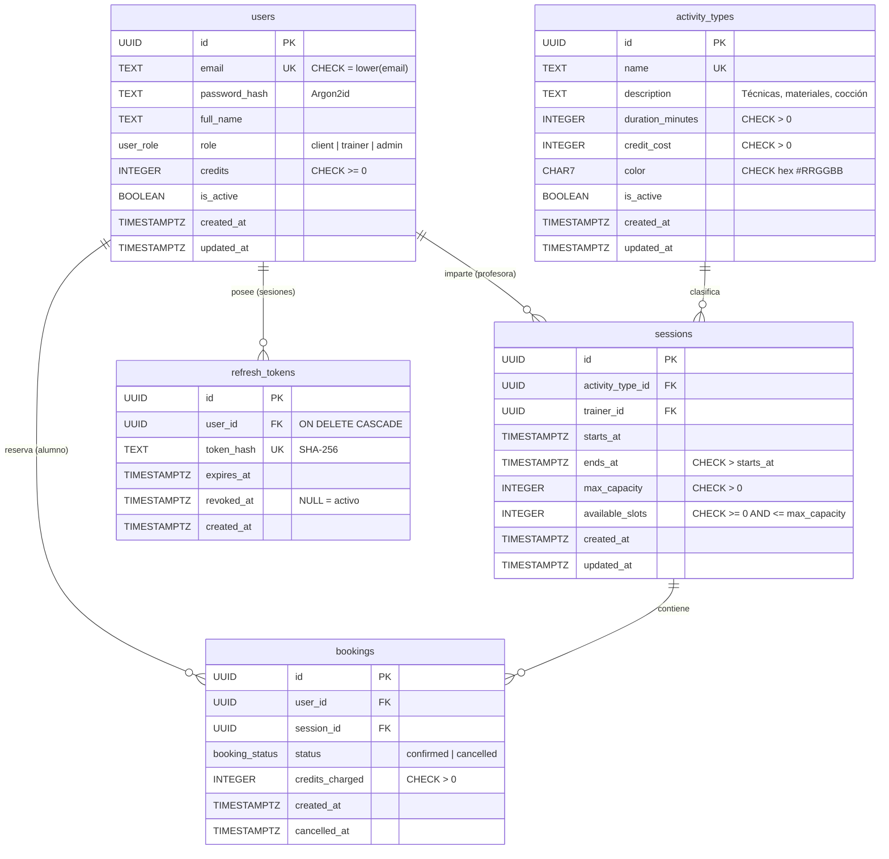
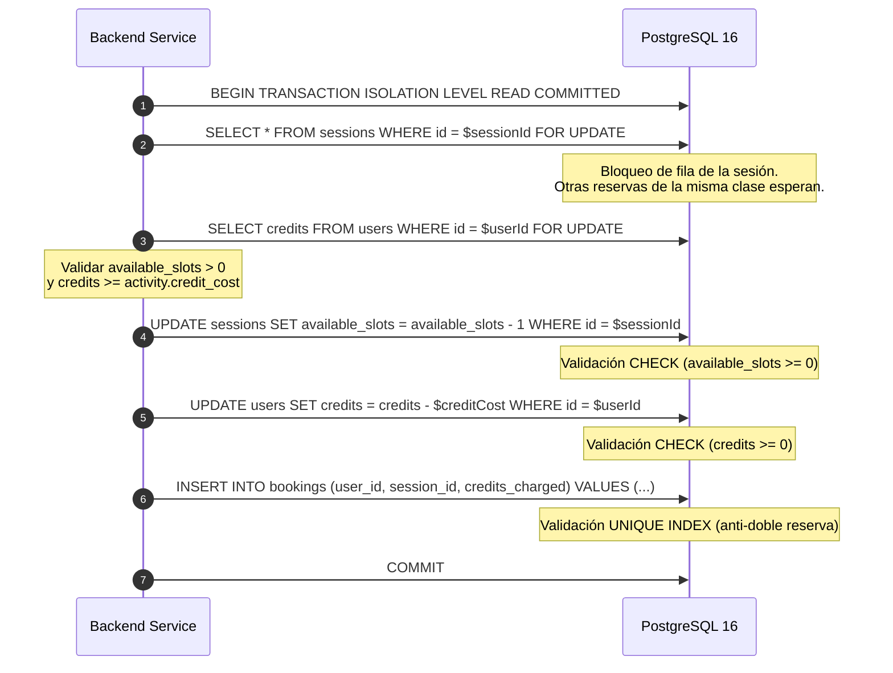

# Especificación del Esquema de Base de Datos · Taller de Cerámica

> **Fuente de verdad:** [specs/schema.sql](file:///home/vruiz-ru/Desktop/Proyectos%20CLI/timp-sdd/specs/schema.sql)  
> **Motor:** PostgreSQL 16  
> **Dominio:** Taller y estudio de clases de cerámica artesanal (torno alfarero, modelado manual, monográficos de esmaltes)  
> **Reglas aplicables:** [AGENT_RULES.md](file:///home/vruiz-ru/Desktop/Proyectos%20CLI/timp-sdd/specs/AGENT_RULES.md) (Reglas 3 y 5)

---

## 1. Modelo Entidad-Relación



---

## 2. Invariantes de Negocio y Restricciones Físicas

| Invariante | Mecanismo SQL | Tabla / Constraint | Propósito |
|---|---|---|---|
| **Créditos nunca negativos** | `CHECK (credits >= 0)` | `users.users_credits_non_negative` | Imposible que un alumno deba créditos a nivel de motor. |
| **Email normalizado** | `CHECK (email = lower(email))` | `users.users_email_lowercase` | Previene colisiones o elusión de cuentas por mayúsculas/minúsculas. |
| **Email único** | `UNIQUE (email)` | `users.users_email_unique` | Unicidad estricta de cuenta. |
| **Plazas nunca negativas** | `CHECK (available_slots >= 0)` | `sessions.sessions_slots_non_negative` | Blindaje físico contra sobre-reserva (*overbooking*). |
| **Plazas dentro de capacidad** | `CHECK (available_slots <= max_capacity)` | `sessions.sessions_slots_within_capacity` | Coherencia del aforo del taller (ej. tornos físicos). |
| **Coste en créditos positivo** | `CHECK (credit_cost > 0)` | `activity_types.activity_types_credit_cost_positive` | Toda actividad consume al menos 1 crédito. |
| **Duración positiva** | `CHECK (duration_minutes > 0)` | `activity_types.activity_types_duration_positive` | Coherencia temporal de actividades. |
| **Color hexadecimal** | `CHECK (color ~ '^#[0-9A-Fa-f]{6}$')` | `activity_types.activity_types_color_hex_format` | Formato UI garantizado para el calendario. |
| **Coherencia horaria** | `CHECK (starts_at < ends_at)` | `sessions.sessions_time_coherence` | La sesión debe finalizar después de empezar. |
| **Anti-doble reserva** | `UNIQUE INDEX (user_id, session_id) WHERE status = 'confirmed'` | `bookings_one_active_per_user_session` | Un alumno no puede reservar dos veces la misma clase activa. |
| **Coherencia de cancelación** | `CHECK ((status = 'confirmed' AND cancelled_at IS NULL) OR ...)` | `bookings.bookings_cancelled_at_coherence` | Garantiza trazabilidad temporal de cancelaciones. |
| **Hash de sesión único** | `UNIQUE (token_hash)` | `refresh_tokens.refresh_tokens_hash_unique` | Unicidad del hash de refresh token. |

---

## 3. Seguridad de Sesiones y Control de Revocación (Regla 5)

La tabla `refresh_tokens` implementa el estándar Zero-Trust:

- **Estructura:** `(id, user_id ON DELETE CASCADE, token_hash UNIQUE, expires_at, revoked_at, created_at)`.
- **Estado activo:** `revoked_at IS NULL AND expires_at > now()`.
- **Revocación por sospecha de robo:**
  ```sql
  -- Invalidación inmediata de todas las sesiones de un usuario comprometido
  UPDATE refresh_tokens
  SET revoked_at = now()
  WHERE user_id = $1 AND revoked_at IS NULL;
  ```
  Acelerada por el índice parcial: `refresh_tokens_idx_active_user`.
- **Desactivación de usuario (`is_active = FALSE`):**  
  Al bloquear una cuenta de usuario, se revocan todas sus sesiones activas de inmediato.
- **Rotación atómica de tokens:**  
  En cada refresco, el token antiguo se marca con `revoked_at = now()` y se inserta uno nuevo dentro de la misma transacción. Si un token ya revocado intenta refrescarse, se activa la alerta de reutilización y se revocan todos los tokens asociados al `user_id`.

---

## 4. Control de Concurrencia en Reservas (Regla 3)

Toda reserva ejecuta la siguiente transacción atómica en el backend:



---

## 5. Datos Iniciales de Prueba (Seed)

El script `schema.sql` incluye los datos iniciales del taller de cerámica:

### 5.1 Usuarios
| Email | Nombre | Rol | Créditos | Estado |
|---|---|---|---|---|
| `admin@tallerbarro.com` | Elena Gómez (Administración Taller) | `admin` | 0 | Activo |
| `carmen.profesora@tallerbarro.com` | Carmen Martínez (Maestra Ceramista) | `trainer` | 0 | Activo |
| `sofia.alumna@example.com` | Sofía Valero | `client` | 4 | Activo |
| `marcos.alumno@example.com` | Marcos Delgado | `client` | 4 | Activo |

*Nota:* Las contraseñas están hasheadas con **Argon2id** (OWASP compliant: `m=19456, t=2, p=1`).

### 5.2 Actividades de Cerámica
| Nombre | Descripción | Duración | Coste Créditos | Color |
|---|---|---|---|---|
| **Torno Alfarero** | Centrado, cilindrado y retorneado de cuencos y jarrones | 120 min | **1** | `#C17A56` (Terracota) |
| **Modelado Manual** | Técnicas de pellizco, churros y planchas para vajilla de gres | 90 min | **1** | `#8A9A5B` (Verde salvia) |
| **Monográfico Esmaltes** | Formulación de vidriados de alta temperatura (1250°C) | 180 min | **2** | `#4682B4` (Azul cobalto) |

### 5.3 Sesiones Programadas para Mañana
| Actividad | Profesora | Horario | Capacidad Máx. | Plazas Libres |
|---|---|---|---|---|
| **Torno Alfarero** | Carmen Martínez | Mañana 10:00 - 12:00 | 6 tornos | **1 plaza libre** (5 ocupadas) |
| **Modelado Manual** | Carmen Martínez | Mañana 16:00 - 17:30 | 10 puestos | **8 plazas libres** (2 ocupadas) |
